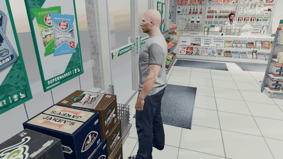
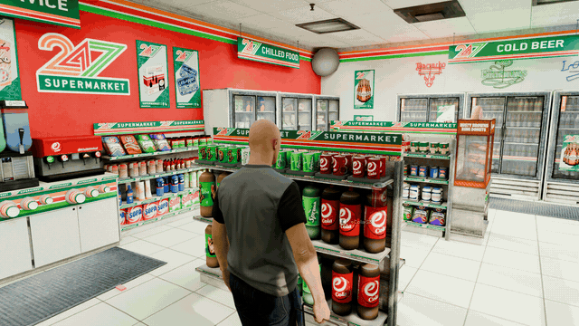
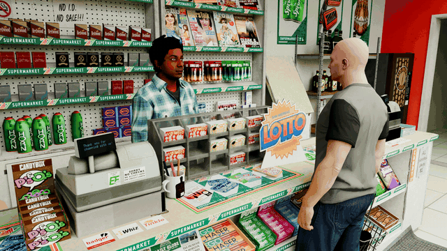
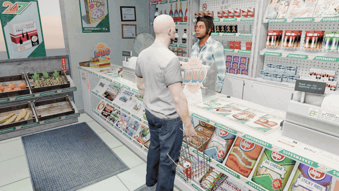

# whip-247 by PureFX

Every 24/7 and LTD store in GTA V, shopped by hand on the [WHIP](https://whipfx.net) FiveM framework. Take the goods
off the game's own racks, carry them in your hands or in a wire basket from the stack by the door, and pay the clerk
in cash or by card. No shop screen: you walk the aisles.

https://github.com/user-attachments/assets/e490c04f-1520-4981-a981-38f74e453cd8

The trailer is rendered in Blender from the resource's own animations, in GTA's own 24/7.
[Download it in 1080p](https://github.com/fozenistaken/pure-whip247/releases/download/v1.0.0/whip-247-trailer.mp4).

| Take a basket off the stack | Pick goods off the racks |
|---|---|
|  |  |
| **Ask the clerk for cigarettes** | **Pay, and the goods go in your pockets** |
|  |  |

## What it does

- **All 14 stores.** The nine 24/7 Supermarkets and five LTD Gasoline stations of GTA V, each with a clerk behind the
  tills (a WHIP NPC) and a map icon.
- **The game's own racks.** Every product that stands on GTA's 24/7 racks and in its fridges has a WHIP prompt with
  its picture and price. Pick it off the shelf; the reach goes low, middle or high to where the product is.
- **Hands or a basket.** Without a basket you carry two small things (one in each hand) or one big one, and everyone
  sees them in your hands. For more, take a red wire basket off the stack by the door: it is GTA's own 24/7 basket,
  carried in your right hand, and what you put in it lies inside it for everyone to see.
- **Animations made for it.** Taking the basket off the stack, reaching the racks with the free hand while carrying
  it, putting goods in the basket, and the clerk turning to the shelf behind the counter to hand over cigarettes.
  Built on the game skeleton from Rockstar's own clips (see [CREDITS.md](CREDITS.md)).
- **The clerk.** Pay in cash or by card, or put everything back. Ask for cigarettes: the clerk takes the pack from the
  shelf behind the counter and hands it over, and it goes on your bill. A pack opens into cigarettes, smoked with
  WHIP's emote.
- **Paying.** WHIP's `ChargePlayer` takes the money and refunds whatever does not fit in your pockets. After paying,
  the goods go from the basket into your pockets and the basket goes back on the stack.
- **Shoplifting.** Walk out of the door without paying and you keep the goods, but the clerk reacts at random: shouts
  after you, cowers behind the counter, or runs after you and beats you up. Some of the time the clerk calls the
  police: with [pure-whip-police](https://github.com/fozenistaken/pure-whip-police) on the server, on-duty officers
  get a "Shoplifting at a 24/7" call with what was taken. All of it is tuned in `Config.Shoplift` (reaction weights,
  chase distance and time, the call's chance and delay); `enabled = false` puts the goods back on the shelves instead.
  The clerk can only be hurt while reacting. Kill the clerk and that store closes for `Config.ClerkDownMinutes` (10)
  until a new clerk takes over.
- **About 40 groceries.** Drinks, snacks, food, home goods and cigarettes, each with its picture. What food and drinks
  restore (hunger, thirst) is changed in game in `/whip` → Economy → Items.
- **Safe by design.** Every request is a WHIP `SecureEvent` with rate limits and checked parameters. The client sends
  which product, never a price; the server checks that you are in that store and at that shelf.

## Install

1. Requires `whip_core` 1.0 or newer, and `whip_media_props` (installed with WHIP) for the item pictures.
2. Put the folder in your resources **named `pure-247`** (the GitHub ZIP unpacks as `pure-whip247-main`: rename it).
   Items, events and prompts are named after the folder.
3. Add `ensure pure-247` after WHIP's lines in `server.cfg`, and start the server.

## Configuration

Everything is in `config.lua`, each setting with a comment:

- `Config.Stores`: the stores and where each clerk stands.
- `Config.Items`: the groceries, their prices, category, picture and what they restore.
- `Config.Shelves`: basket limits, how much you carry by hand, how far you can walk before the basket goes back, and
  how the basket sits in the hand. Staff fine-tune the hand hold in game with `/basketedit` (developer mode).

## For other resources

- `exports['pure-247']:GetStores()` lists the stores, their place and their prices.
- The server event `pure-247:purchased` fires after every purchase with the store, the payment method and the items.

## Licence

[CC BY-NC-SA 4.0](LICENSE.md): use it and change it, keep the credit, share changes under the same licence, and do not
sell it. The basket model and the animation clips in `stream/` are made from GTA V's own assets and belong to Rockstar
Games; see [CREDITS.md](CREDITS.md).

By fozen ([PureFX](https://purefx.dev)).
